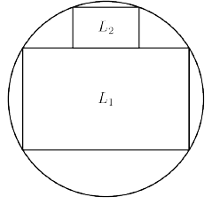

In the diagram shown, the rectangles $L_1$ and $L_2$ are similar, where corresponding sides of $L_1$ are $\frac{5}{2}$ times the length of the corresponding sides of $L_2$. Rectangle $L_1$ is inscribed in a circle $\omega$, and rectangle $L_2$ meets $\omega$ at two points, with its long side lying on the long side of $L_1$. If $r$ and $s$ are the side lengths of $L_1$, where $s>r$, compute $\frac{s}{r}$.

