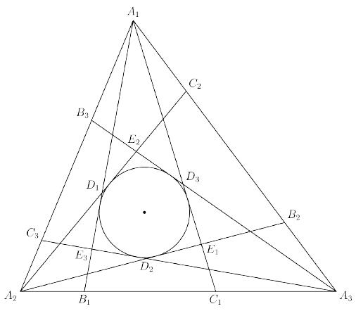

Triangle $\triangle A_1A_2A_3$ has side lengths $A_1A_2=13$, $A_2A_3=14$, $A_3A_1=15$. Points $B_i$ and $C_i$ lie on $\overline{A_{i+1}A_{i+2}}$ such that $\angle B_iA_iC_i=30^\circ$ for $1\leq i\leq3$, where $A_4=A_1$ and $A_5=A_2$. For $1\leq i\leq3$, let $D_i$ be the intersection of $\overline{A_iB_i}$ and $\overline{A_{i+1}C_{i+1}}$ and $E_i$ the intersection of $\overline{A_iC_i}$ and $\overline{A_{i+1}B_{i+1}}$, where $A_4=A_1$, $B_4=B_1$, $C_4=C_1$. If $D_1E_3D_2E_1D_3E_2$ forms a convex hexagon with an inscribed circle of radius $r$, compute $r$.

