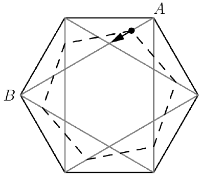

In the diagram, the larger regular hexagon has side length 1. A black dot moves with constant velocity from $A$ to $B$, two vertices on the larger hexagon as shown in the diagram. The dashed regular hexagon is then drawn with one of its vertices on the black dot while remaining rotationally symmetric with respect to the center of the larger hexagon (i.e. the dashed hexagon has the same center as the large hexagon). Compute the average area of the dashed hexagon over time as the black dot travels from $A$ to $B$.

