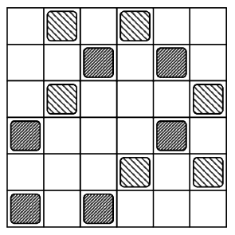

On a $6\times 6$ grid, $12$ identical pebbles are placed in the cells such that there are exactly $2$ pebbles in every row and every column. Partition the pebbles into groups by declaring that two pebbles belong to the same group if one can reach the other by a sequence of moves between pebbles that lie in the same row or the same column. For example, in the grid shown, there are two groups.

Given a valid arrangement $A$ of these $12$ pebbles, define $f(A)$ to be the number of groups in $A$. Let $S$ be the set of all valid arrangements $A$. Compute $\sum_{A\in S}2^{f(A)}$.
