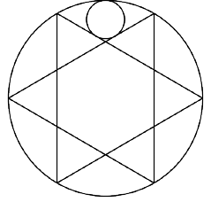

In the diagram to the right, the two equilateral triangles intersect to form a regular hexagon. Circle $\omega$ is tangent to both equilateral triangles and internally tangent to the circumcircle $\Omega$ of both triangles. If the radius of $\Omega$ is 1, compute the radius of $\omega$.

