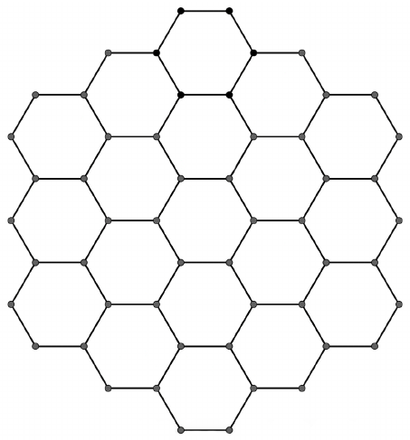

In the grid to the right, you want to color as many hexagons red as possible. However, no three adjacent hexagons whose centers lie on the same line can be colored red. Compute the maximum number of hexagons you can color red.

