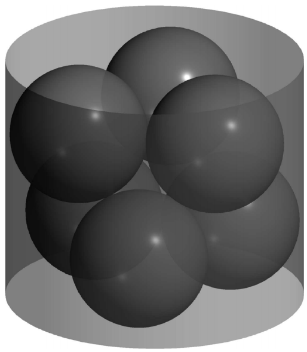

Six spheres of radius $1$ are placed inside a cylinder (with bases parallel to the ground) in two layers, as shown in the image. Each layer consists of three spheres all tangent to each other, and each sphere in the top layer is tangent to two spheres in the bottom layer. The cylinder’s wall is tangent to all six spheres, and each of its bases is tangent to the three spheres in one layer. Compute the height of the cylinder.

