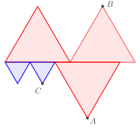

Пять равносторонних треугольников расположены так, как показано на рисунке ниже. Три больших треугольника равны между собой и два маленьких тоже равны между собой. Найдите углы треугольника $ABC$.

