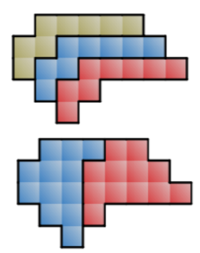

Назовём полоской клетчатый многоугольник, который можно пройти целиком, начав из какой-то его клетки и далее двигаясь только в двух направлениях — вверх или вправо. Несколько таких одинаковых полосок можно вставить друг в друга, сдвигая на вектор $(-1, 1)$. Докажите, что для любой полоски, состоящей из чётного числа клеток, найдётся такое нечётное $k$, что если объединить $k$ таких же полосок, вставив их последовательно друг в друга, то полученный многоугольник можно будет разделить по линиям сетки на две равные части. (На рисунке приведён пример.)

