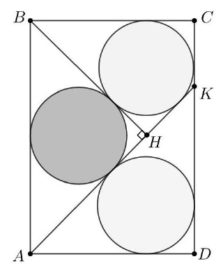

На стороне $CD$ прямоугольника $ABCD$ взята точка $K$. Из вершины $B$ опустили перпендикуляр $BH$ на отрезок $AK$. Оказалось, что отрезки $AK$ и $BH$ делят прямоугольник на три части, в каждую из которых можно вписать круг (см. рисунок). Докажите, что если круги, касающиеся стороны $CD$, равны, то и третий круг им равен.

