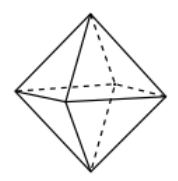

Каждую грань правильного октаэдра (см. рисунок) разбили средними линиями на правильные треугольники (всего получилось 32 одинаковых маленьких правильных треугольника). Какое наибольшее число этих треугольников можно закрасить так, чтобы закрашенные треугольники не имели общих вершин?

