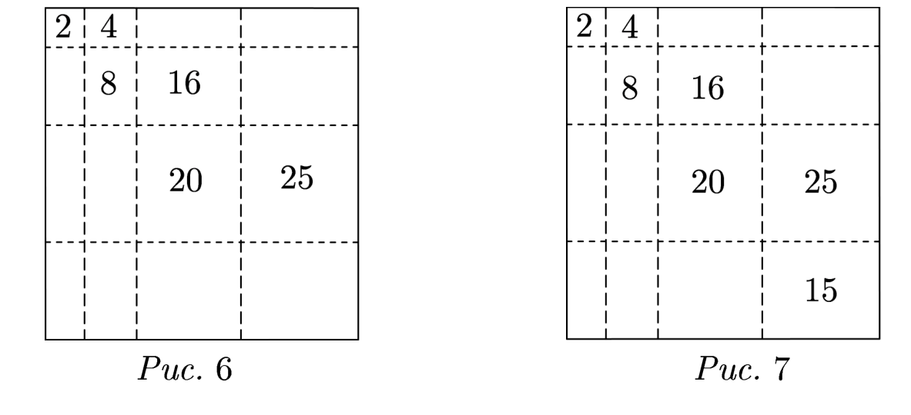

Прямокутник розбитий на $16$ прямокутників, у яких невідомі довжини сторін.

**1.** Відома площа шести малих прямокутників, які утворилися внаслідок розбиття, і їх площі наведені на рис. 6. Знайти площі кожного з чотирьох маленьких прямокутників, розташованих у нижньому ряду, якщо площа усього великого прямокутника складає $168$.

**2.** Відома площа сімох малих прямокутників, які утворилися внаслідок розбиття. Їх площі наведені на рис. 7. Знайти площу усього великого прямокутника.

