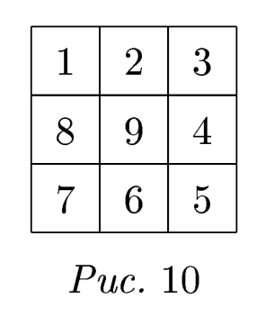

Розглянемо квадрат, який має сторону $3$ та розбитий на $9$ квадратів зі стороною $1$, яким задано номери, як на рис. 10. Всередині (але не на межі!) малих квадратів за номерами $1, 3, 5, 7$ вибрані довільним чином точки $A, B, C, D$ відповідно. Позначимо через $X$ спільну площу чотирикутника $ABCD$ та квадратів з номерами $1, 3, 5$ та $7$, а через $Y$ аналогічно позначимо спільну площу чотирикутника $ABCD$ та квадратів з номерами $2, 4, 6$ та $8$. Довести, що $X < Y$.

