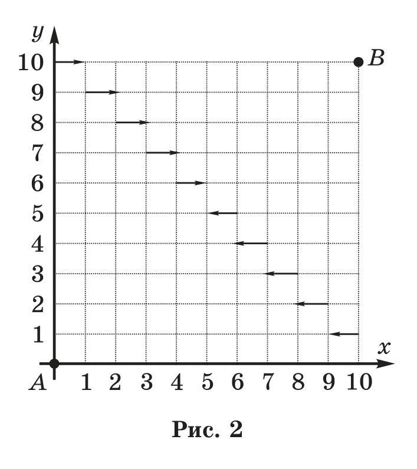

У космічному квадраті з діагоналлю $A(0, 0)\ B(10, 10)$ космічний човен має доставити секретний лист із точки $A$ в точку $B$. Човну дозволяється рухатись таким чином: перебуваючи в точці $(n_1, m_1)$, де $n_1$, $m_1$ - цілі числа однакової парності, переміститись по прямій у будь-яку точку $(n_2, m_2)$, де $n_2 > n_1$, $m_2 > m_1$ та цілі числа $n_2, m_2$ також мають однакову парність. Вороги встановили радари, які дозволяють виявити човен. Зону покриття радарів показано жирними відрізками на рис. 2 (точка, на яку вказує стрілка на кінці відрізка, не входить до зони дії радара). Човен буде виявлено, якщо його траєкторія перетне зону дії хоча б одного радара. Яких траєкторій руху космічного човна більше: тих, де човен буде виявлено, чи тих, де човен помічено не буде?

