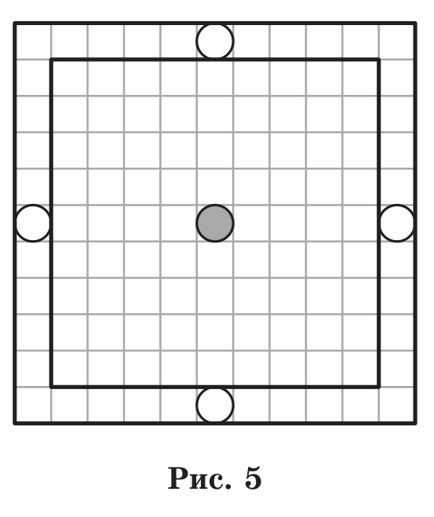

На центральному полі дошки розміром $11\times 11$ стоїть чорна фішка, а на серединах сторін зовнішнього квадрата - $4$ білі фішки (рис. 5). Гравець, що грає чорною фішкою, ходить першим. За один хід він може пересунути чорну фішку вздовж сторони на будь-яку сусідню клітину, якщо на ній не стоїть біла фішка. Другий гравець кожним своїм ходом виставляє ще одну білу фішку на периметрі квадрата, але обов'язково в таке поле, що межує вздовж сторони з іншим полем, у якому вже стоїть біла фішка. Перший гравець ви́грає, якщо йому вдасться досягти зовнішньої межі квадрата. Якщо другий гравець зможе цьому завадити, то виграє він. Хто здобуде перемогу в такій грі: перший чи другий гравець?

