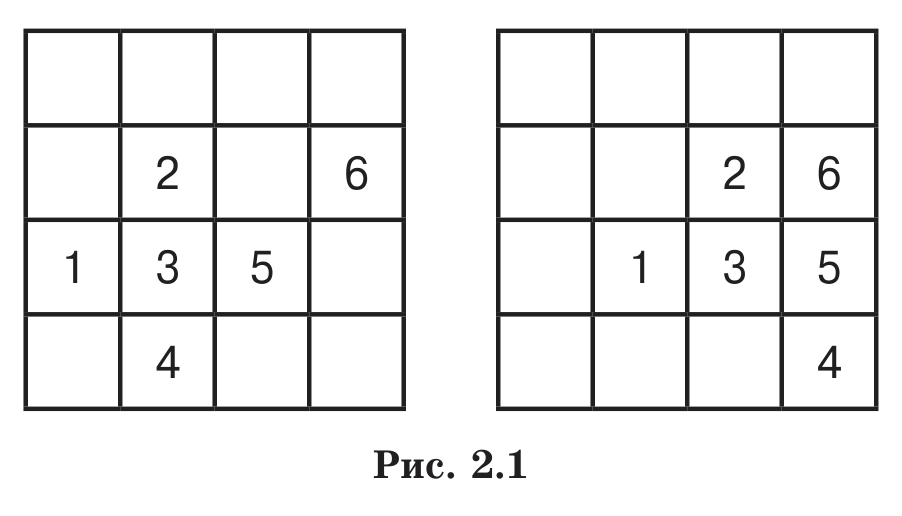

У деяких клітинках дошки $4 \times 4$ стоять кубики. Спершу дошку нахиляють праворуч, унаслідок чого кубики ковзають на її правий бік: кожен кубик притискається до правої межі дошки або до іншого кубика (рис. 2.1). Далі дошку нахиляють послідовно вгору, ліворуч і вниз, а кубики притискаються відповідно спершу до верхньої, потім до лівої і врешті до нижньої межі дошки. Чи існує таке початкове розташування кубиків, що після всіх нахилянь дошки деякі два кубики поміняються місцями? При цьому інші кубики можуть опинитися на довільних місцях.

