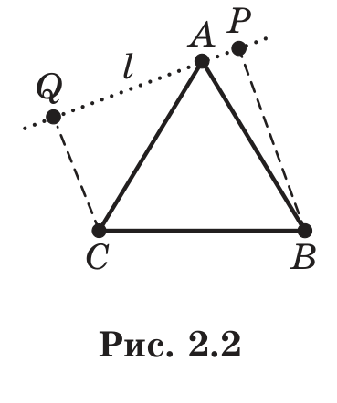

Задано рівносторонній трикутник $ABC$, у якого $A_1$, $B_1$, $C_1$ - середини сторін $BC$, $AC$, $AB$ відповідно. Пряма $l$ проходить через вершину $A$. Позначимо через $P$, $Q$ проекції точок $B$, $C$ на пряму $l$ відповідно (пряму $l$ і точки $Q$, $A$, $P$ розташовано так, як це показано на рис. 2.2). Позначимо через $T$ точку перетину прямих $B_1P$ і $C_1Q$. Доведіть, що пряма $A_1T$ перпендикулярна до прямої $l$.

