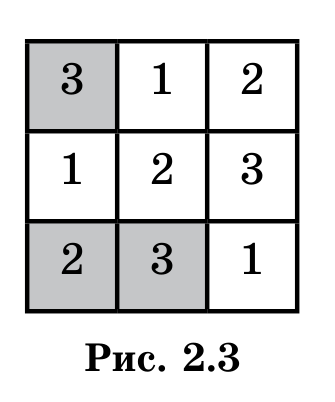

У таблиці розміром $n \times n$ стовпчики перенумеровано зліва направо числами $1, 2, \ldots, n$. У комірки таблиці розставляють числа $1, 2, \ldots, n$ таким чином, щоб у кожному рядку та в кожному стовпчику траплялося кожне із чисел $1, 2, \ldots, n$. У кожному стовпчику зафарбовують сірим ті комірки, у яких записано число, що більше від номера цього стовпчика. На рис. 2.3 показано приклад такого фарбування для деякої розстановки чисел при $n = 3$. Чи може статися так, щоб кількість сірих комірок у кожному рядку була однакова, якщо:

а) $n = 5$;

б) $n = 10$.

