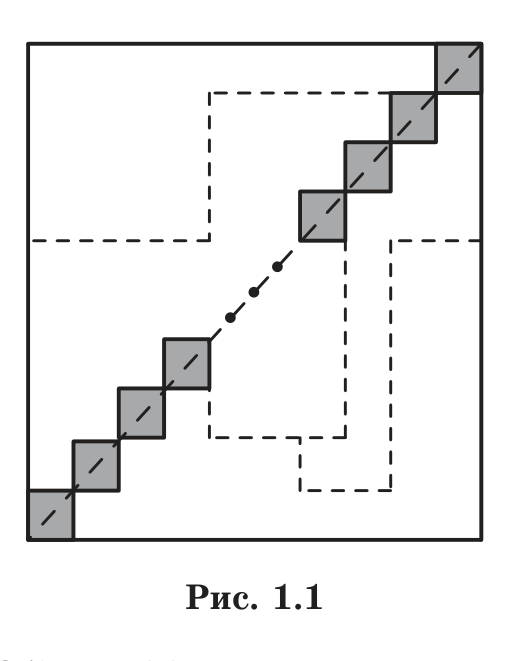

На аркуші паперу в клітинку нарисували квадрат, сторони якого йдуть по лініях клітинок. У квадраті провели одну діагональ і всі клітинки, через центри яких вона проходить, пофарбували в чорний колір. Після цього клітинки квадрата, що розташовані над чорними, деяким чином поділили на дві фігури, а клітинки, що розташовані під чорними, - на три фігури, наприклад так, як це показано на рис. 1.1. Площі (кількість клітинок) чотирьох із п'яти фігур виявилися такими: $70$, $80$, $90$ та $100$. Якою може бути площа п'ятої фігури?

