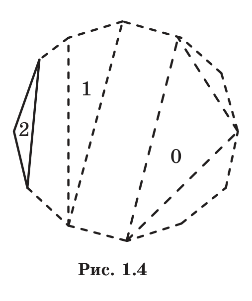

На колі вибрано $2016$ точок. Їх послідовно сполучено за рухом годинникової стрілки таким чином, що утворився $2016$-кутник. Аліса та Базиліо за чергою (розпочинає Базиліо) проводять у ньому діагоналі, які можуть перетинатися лише у вершинах многокутника, доки це можливо. По завершенні гри многокутник буде розбито на трикутники трьох типів - нульові, одиничні та двійкові, залежно від того, скільки сторін трикутника збігається зі сторонами заданого многокутника (рис. 1.4). У прикінцевому розподілі Аліса отримує $1$ золоту монету за кожний нульовий трикутник, а Базиліо - $1$ золоту монету за кожний двійковий трикутник. Хто з них може отримати більше золотих монет та на скільки за умови правильної гри обох?

