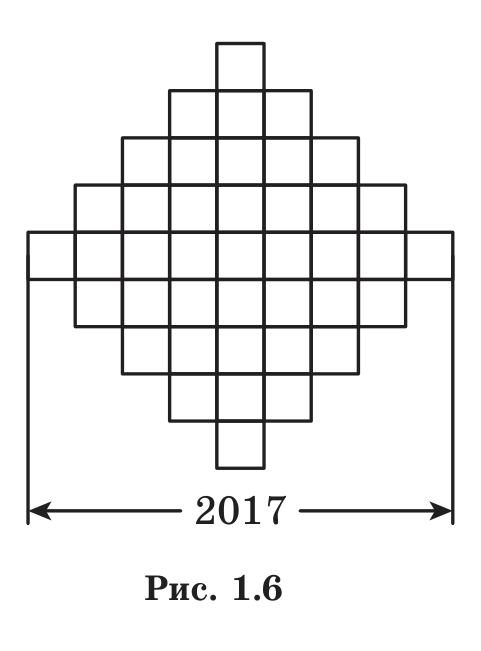
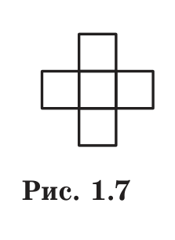

У кожній клітинці фігури "великий хрест" (рис. 1.6) стоїть число "$+1$". За один крок можна замінити знак на протилежний у всіх клітинках фігури "хрест" (рис. 1.7), що повністю розташована всередині "великого хреста". Чи можна за скінченну кількість кроків одержати "великий хрест", повністю заповнений числами "$-1$"?

