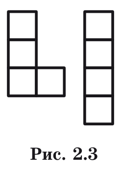

Чи можна непарною кількістю $L$-тетраміно та певною кількістю прямих тетраміно (рис. 2.3) замостити деякий прямокутник? Тетраміно не можуть виходити за межі прямокутника, кожна клітинка прямокутника має бути покрита рівно одним тетраміно.

