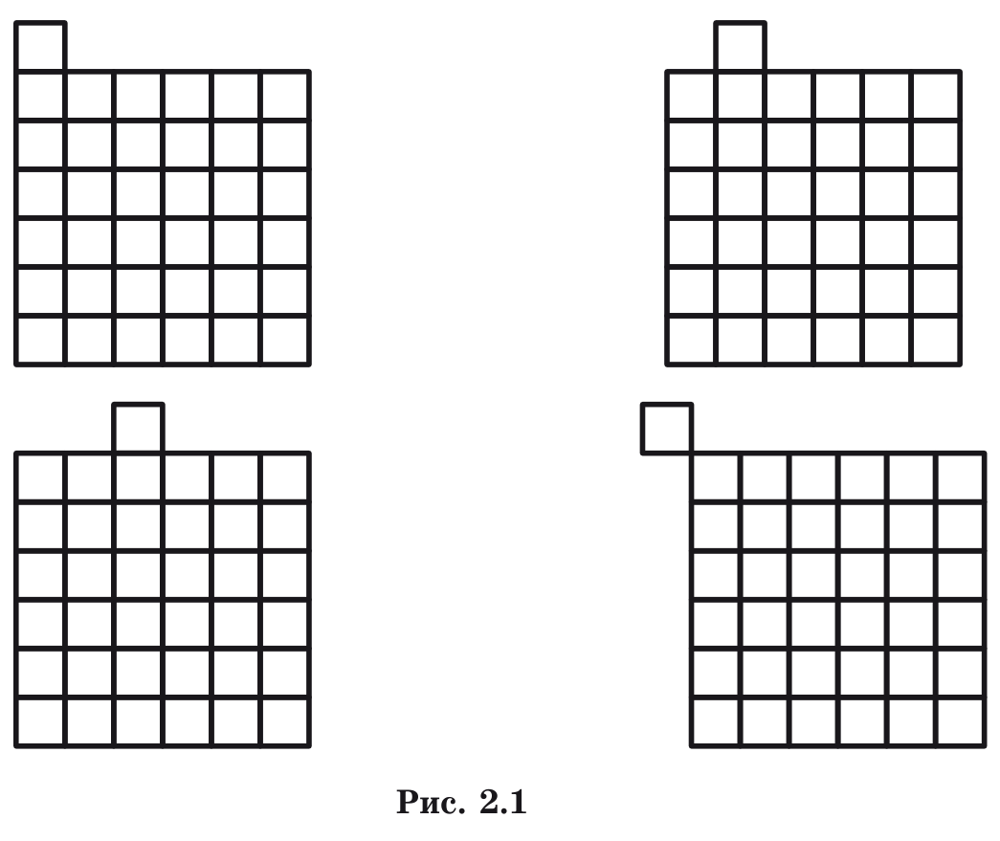

Назвемо *квазіквадратом* фігуру, що складається з квадрата $n \times n$, до якого зовні приєднано ще один квадратик $1 \times 1$, що має спільну сторону з одним із квадратиків квадрата $n \times n$, а також спільну вершину з одним з кутових квадратиків квадрата $n \times n$. Так, на рис. 2.1 дві верхні фігури є квазіквадратами, а дві нижні - ні. Для яких $n \geqslant 3$ можна однаковими квазіквадратами заповнити всю площину? Квазіквадрати не мають накладатися один на одний, але їх можна повертати та перевертати.

