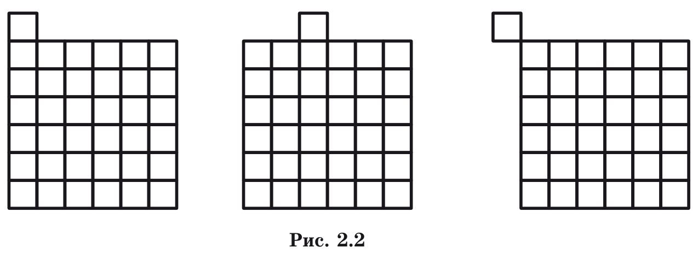

Назвемо *квазіквадратом* фігуру, що складається з квадрата $n\times n$, $n\geqslant 4$, до якого зовні приєднано ще один квадратик $1\times1$, що має спільну сторону з одним із квадратиків квадрата $n\times n$. Так, на рис. 2.2 дві перші фігури є квазіквадратами, третя - ні. Чи завжди можна такими однаковими квазіквадратами покрити всю площину?

*Примітка.* Квазіквадрати не можна накладати один на одний, але їх можна повертати та перевертати. Відповідь треба дати для всіх $n\geqslant 4$ та всіх можливих квазіквадратів.

