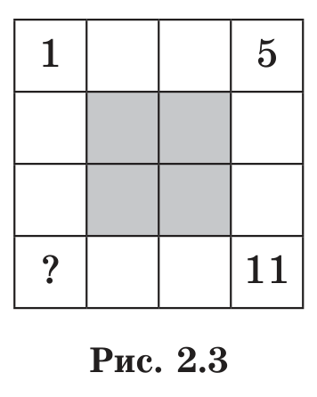

Клітинки $1 \times 1$, що розташовані по периметру квадрата $4 \times 4$, заповнено числами $1$, $2$, $\ldots$, $12$ так, що суми чисел уздовж кожної із чотирьох сторін рівні. У лівій верхній кутовій клітинці стоїть число $1$, у правій верхній - число $5$, а в правій нижній - число $11$ (рис. 2.3). Яке число за таких умов може бути розташованим в останній, лівій нижній кутовій клітинці?

