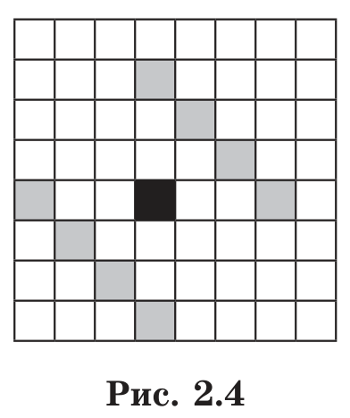

Фігура *косий кінь*, що розташована на чорному полі шахівниці $8 \times 8$ (рис. 2.4), атакує всі сірі клітинки. Яку найбільшу кількість таких косих коней можна виставити на шахівницю, щоб вони не атакували один одного?

