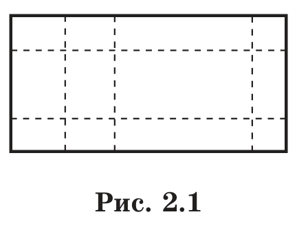

Андрій та Олеся по черзі (починає Андрій) у прямокутнику розміром $2 \times 1$ проводять горизонтальні відрізки довжиною $2$ чи вертикальні довжиною $1$, як показано на рис. 2.1. Після кожного ходу вони підраховують сумарний периметр $P$ усіх малих прямокутників, що при цьому утворилися (тобто таких, усередині яких не проходить жодний інший відрізок). Перемагає той із них, після чийого ходу значення $P$ ділиться націло на $2021$. Хто переможе, якщо кожен із гравців прагне перемогти?

