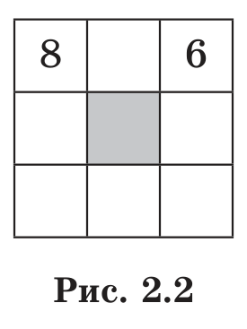

Клітинки $1 \times 1$, що розташовані по периметру квадрата $3 \times 3$, заповнено числами $1, 2, \ldots, 8$ так, що суми чисел уздовж кожної із чотирьох сторін рівні. У лівій верхній кутовій клітинці стоїть число $8$, а в правій верхній - число $6$ (рис. 2.2). Скільки існує різних заповнень числами решти клітинок за таких умов?

