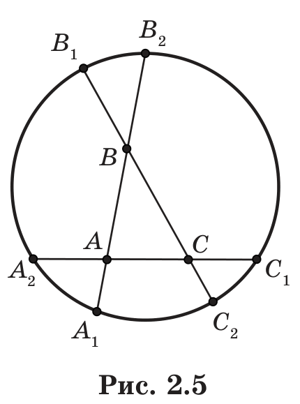

Сторони трикутника $ABC$ продовжили в обидва боки та на цих продовженнях у зовнішній бік відклали шість відрізків $AA_1, AA_2, BB_1, BB_2, CC_1, CC_2$ однакової довжини (рис. 2.5). Виявилося, що всі $6$ точок $A_1, A_2, B_1, B_2, C_1, C_2$ лежать на одному колі. Чи обов'язково трикутник $ABC$ є рівностороннім?

