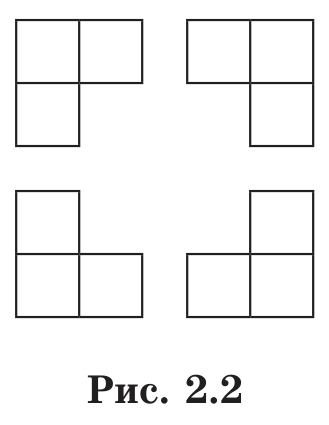

Задано натуральні числа $m$, $n$ такі, що число $mn$ ділиться на $9$, але не ділиться на $27$. Прямокутник розміром $m \times n$ розрізали на куточки з трьох клітинок. Залежно від того, як орієнтовані ці куточки, поділимо їх на чотири типи (рис. 2.2). Чи могло так статися, що кількості куточків кожного типу є точними квадратами деяких натуральних чисел?

