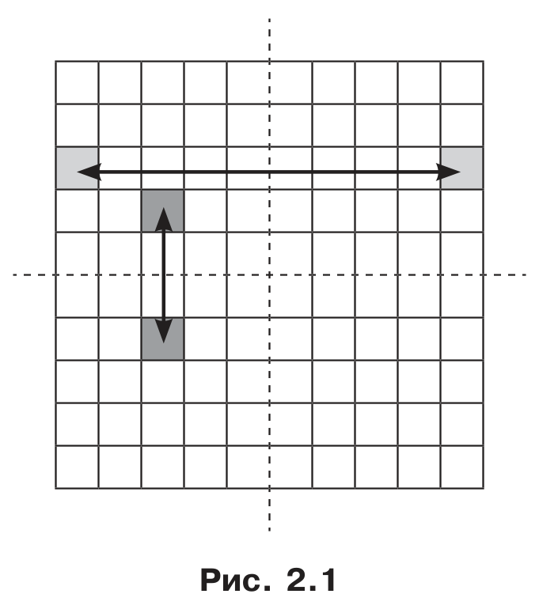

Чи можна вписати числа від $1$ до $100$ в клітинки квадрата $10 \times 10$ так, щоб у кожну клітинку було записане рівно одне число, кожне число було записане рівно один раз та щоб числа в клітинках, симетричних відносно якогось із серединних перпендикулярів, проведених до сторін початкового квадрата, були однакової парності? На рис. 2.1 показано приклади таких пар клітинок, у яких записані числа мають бути однакової парності.

