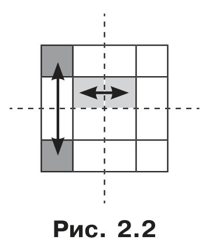

Запишіть натуральні числа від $1$ до $16$ у клітинки квадрата $4 \times 4$ так, щоб в кожну клітинку було записане рівно одне число, кожне число було записане рівно один раз та щоб числа в клітинках, симетричних відносно якогось із серединних перпендикулярів, проведених до сторін початкового квадрата, давали в сумі просте число. На рисунку 2.2 показано приклади таких пар клітинок, суми чисел у яких мають бути простими числами.

