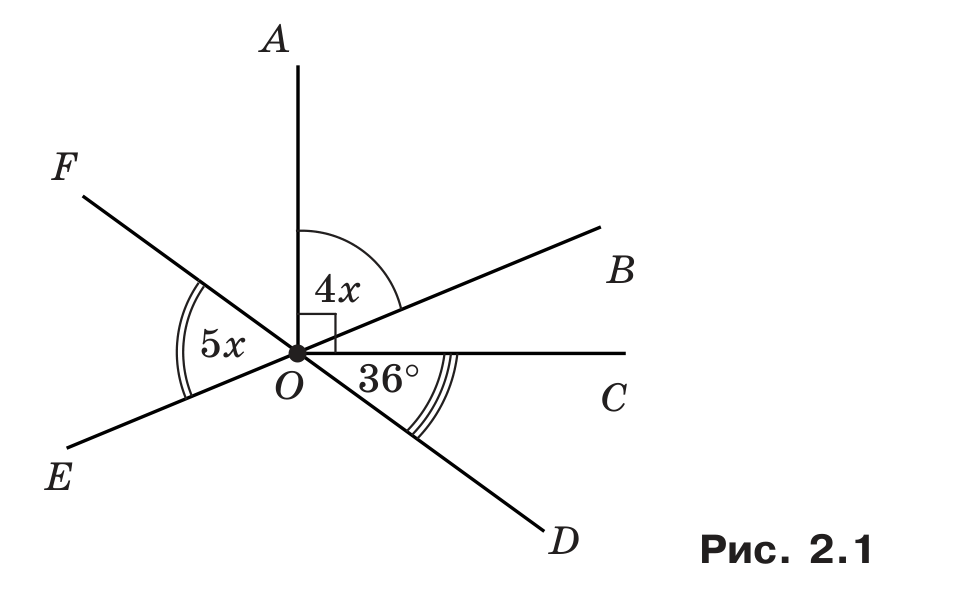

Прямі $FD$ та $BE$ перетинаються в точці $O$. З точки $O$ проведено також промені $OA$ та $OC$, при цьому про кути, що утворилися, відомі такі умови: $\angle DOC=36^\circ$, $\angle AOC=90^\circ$, $\angle AOB=4x$ та $\angle FOE=5x$, як це показано на рис. 2.1. Чому дорівнює градусна міра величини $x$?

