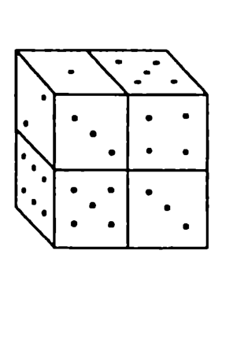

Незнайка купив у магазині чотири однакові гральні кубики. Граючись, він став прикладати їх один до одного гранями з однаковою кількістю очок. У результаті з'явилась конструкція, зображена Незнайком на рисунку. Знайка, подивившись на рисунок, заявив, що Незнайка помилився. Чи правий Знайка?

