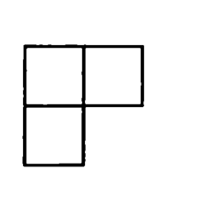

На клітчастому папері намальовано квадрат розміром $100\times 100$. Яку найменшу кількість його клітинок потрібно зафарбувати, щоб із незафарбованої частини неможливо було вирізати по лініях сітки триклітинкової фігурки (у будь-якому розташуванні), зображеної на рисунку?

