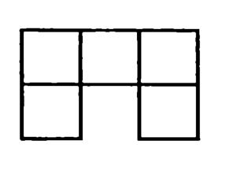

Чи можна таблицю розміром $10\times 10$ заповнити натуральними числами так, щоб у кожній п'ятиклітинковій фігурці (у довільному розташувані), зображеній на рисунку, сума чисел дорівнювала $105$, а сума чисел у будь-яких двох клітинках зі спільною стороною дорівнювала $40$?

