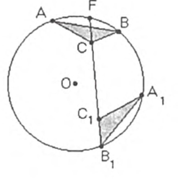

Вершини $A$ і $B$ трикутника $ABC$ лежать на колі з центром $O$. Точки $C$ і $O$ знаходяться по один бік від прямої $AB$. Поворотом трикутника $ABC$ навколо точки $O$ отримали трикутник $A_1B_1C_1$, причому промінь $B_1C_1$ проходить через вершину $C$ і перетинає коло в точці $F$. Доведіть, що $CF = CB$.

