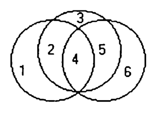

Три однакові круги розташовані так, як показано на рисунку, причому площа кожної з 6 частин дорівнює цілому числу квадратних сантиметрів. Доведіть, що коли із суми площ першої, третьої і шостої частин відняти площі другої й п'ятої частин, то одержимо ціле число, яке ділиться без остачі на 3.

