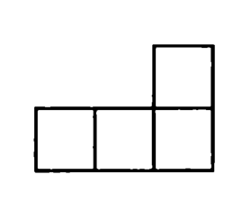

Заповніть таблицю розміром $8 \times 8$ числами $1$, $2$ і $-4$ так, щоб у будь-якому квадраті розміром $4 \times 4$ сума чисел була рівною нулю, а у будь-якій фігурці, зображеній на рисунку, сума чисел була ненульовою. (Фігурку можна повертати й перевертати.)

