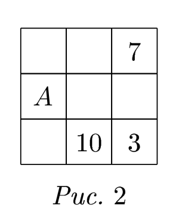

Магічний квадрат $3 \times 3$ - це квадрат, у кожній комірці якого записані числа таким чином, що сума чисел у кожному рядку, у кожному стовпчику та у кожній з двох великих діагоналей співпадають. На рис. 2 показано, які числа записані у трьох комірках. Яке число може бути записане у комірці, що позначена літерою $A$? Відповідь обґрунтувати.

