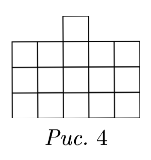
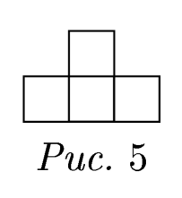

Є дошка, що зображена на рис. 4, яка складається з $16$ одиничних квадратів. Ми хочемо деякі з одиничних квадратиків пофарбувати у зелений колір таким чином, щоб з дошки не можна було вирізати фігурку Т-тетраміно, яка зображена на рис. 5, у якої немає жодного зафарбованого у зелений колір одиничного квадратика (розрізати можна лише вздовж ліній, що містять межі квадратів). Яку найменшу кількість квадратиків ми маємо зафарбувати? Відповідь обґрунтувати.

