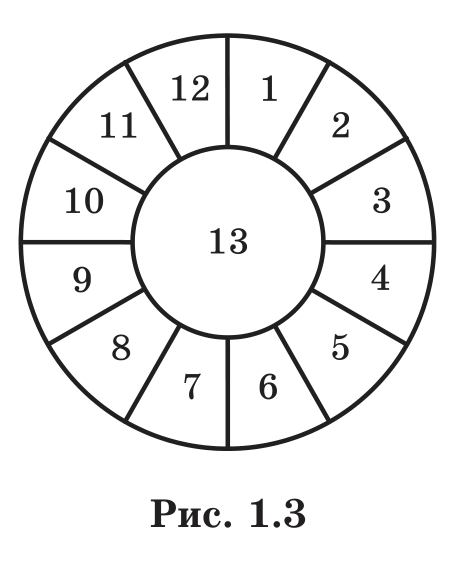

У скільки способів можна розфарбувати всі $13$ частин круга, зображеного на рис. 1.3, у три кольори так, щоб жодні дві частини, пофарбовані однаково, не мали спільної межі? Два розфарбування вважатимемо різними, якщо хоча б одна з $13$ частин у першому розфарбуванні пофарбована інакше, ніж у другому.

