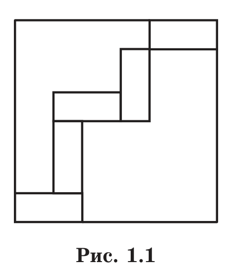

Усередині квадрата зі стороною $6$ розмістили п'ять однакових прямокутників, як це показано на рис. 1.1 (сторони прямокутників паралельні сторонам квадрата). Знайдіть площу одного такого прямокутника.

