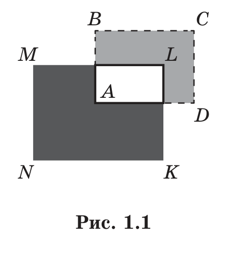

Прямокутники $ABCD$ та $KLMN$ зі сторонами $AB=3$, $BC=5$, $MN=4$ та $ML=6$, розташовані, як показано на рисунку 1.1. Відомо, що площа сірої частини прямокутника $ABCD$ дорівнює $10$. Визначте, чому дорівнює площа чорної частини прямокутника $KLMN$.

