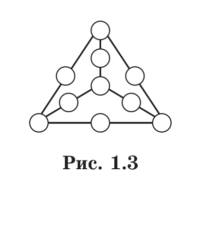

Чи можна розставити у $10$ кружечках, наведених на рисунку 1.3, числа $1$, $2$, $\ldots$, $10$ (кожне число по разу) таким чином, щоб сума чисел у трьох кружечках уздовж кожного із шести відрізків була однаковою?

