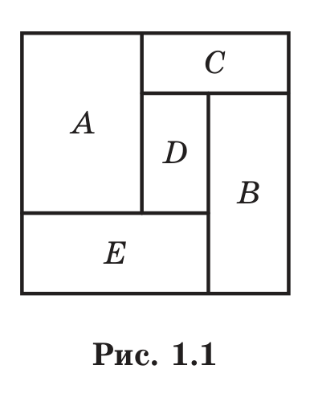

На папері в клітину нарисовано квадрат розміром $9 \times 9$ клітин. Розріжте його по лініях клітин таким чином, щоб серед отриманих $5$ частин $A$, $B$, $C$, $D$ і $E$ (рис. 1.1) найбільшу площу мала частина $A$, а найбільший периметр - частина $B$.

