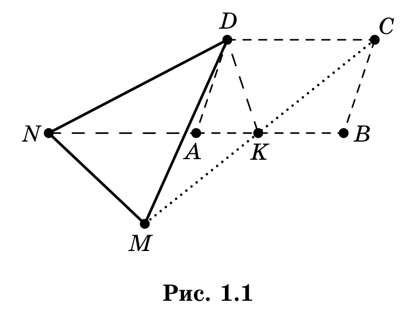

У паралелограмі $ABCD$ відомо, що $AB = BD$. На відрізку $AB$ відмітили точку $K$, відмінну від точки $A$ і таку, що $KD = AD$. На промені $CK$ відклали відрізок $KM = CK$, а на промені $BA$ - відрізок $AN = AB$. Доведіть, що $DN = DM$.

*Примітка.* Вважаємо, що вказані точки розташовані так, як це показано на рис. 1.1.

