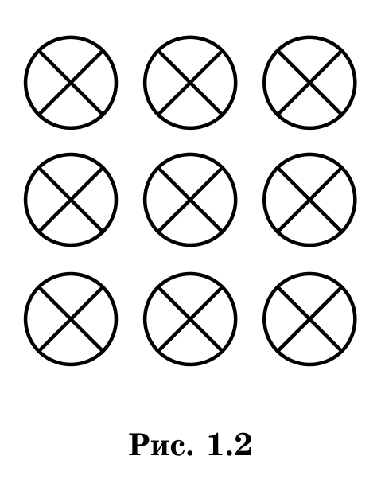

Лампи розташовані у вигляді квадрата розміром $3 \times 3$ (рис. 1.2). Лампи можуть бути у стані "горить" чи "не горить". Є дев'ять перемикачів, які відповідають кожній лампі. При цьому в разі натискання відповідного перемикача змінюють свій стан на протилежний ("горить" на "не горить" та навпаки) усі лампи, що розташовані в одному рядку та одному стовпчику з відповідною лампою. Спочатку всі лампи "не горять". Яку найменшу кількість натискань перемикачів треба зробити, щоб усі лампи перейшли в стан "горить"?

