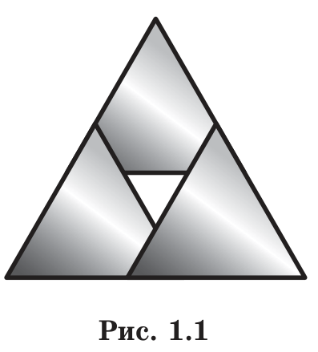

Рівносторонній трикутник зі стороною $36$ покривають трьома рівними рівносторонніми трикутниками зі стороною $21$ (рис. 1.1). Визначте довжину сторони рівностороннього трикутника, який залишився непокритим.

