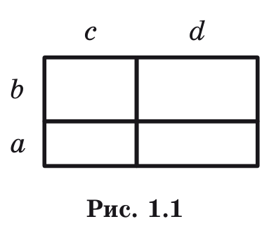

На рис. 1.1 можна побачити $9$ різних прямокутників - $4$ маленьких, $4$ середніх, кожен з яких складається з двох маленьких, та $1$ великий. Відомо, що у кожного з них довжини сторін - цілі числа. Скільки із цих прямокутників можуть мати площу, яка дорівнює непарному числу? Укажіть усі можливі відповіді.

